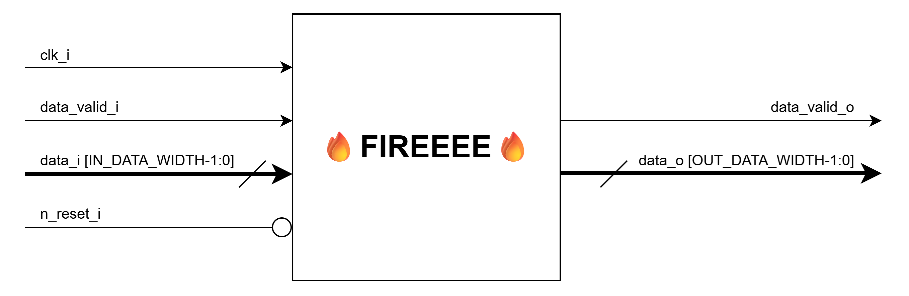

# fireeee
<ins>**FIR**</ins> filter as <ins>**E**</ins>asily, <ins>**E**</ins>xpandable, <ins>**E**</ins>nhanceable and <ins>**E**</ins>mbedded

## File list
|File name|Description|
|:-|:-|
|[fireeee.v]()|Verilog module|
|[fireeee_tb.sv]()|SystemVerilog testbench|
|||

## Parameters
|Parameter|Description|
|:-|:-|
|IN_DATA_WIDTH|Input data bit width|
|COEF_WIDTH|Filter coefficient bit width|
|COEF_DEPTH|Filter length|
|COEF_INIT_FILE|Filter coefficient initialization file name|
|OUT_DATA_WIDTH|Output data bit width|

## Port definition
### Input
|Port|Description|
|:-|:-|
|clk_i|Clock signal|
|data_valid_i|Data input valid signal|
|data_i [IN_DATA_WIDTH-1:0]|Data input signal|
|nreset_i|Synchronous reset signal (Active LOW)|

### Output
|Port|Description|
|:-|:-|
|data_valid_o|Data output valid signal|
|data_o [OUT_DATA_WIDTH-1:0]|Data output signal|

## Block diagram
### Summary

### Detail
TBD

## Timing Chart
TBD

## Module description
TBD