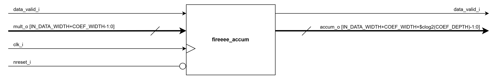
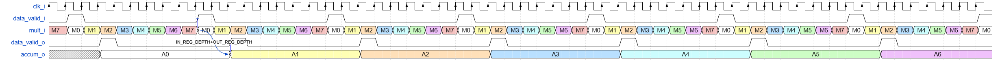

# fireeee_accum
Accumulator

## File list
|File name|Description|
|:-|:-|
|[fireeee_accum.v]()|Verilog module|
|[fireeee_accum_tb.sv]()|SystemVerilog testbench|

## Parameters
|Parameter|Description|
|:-|:-|
|IN_DATA_WIDTH|Input data bit width|
|COEF_WIDTH|Filter coefficient bit width|
|COEF_DEPTH|Filter length|
|IN_REG_DEPTH|Input pipeline register depth|
|OUT_REG_DEPTH|Output pipeline register depth|

## Port definition
### Input
|Port|Description|
|:-|:-|
|clk_i|Clock signal|
|data_valid_i|Data input valid signal|
|mult_i [IN_DATA_WIDTH+COEF_WIDTH-1:0]|Multiplied data input signal|
|nreset_i|Synchronous reset signal (Active LOW)|

### Output
|Port|Description|
|:-|:-|
|data_valid_o|Data output valid signal|
|accum_o [IN_DATA_WIDTH+COEF_WIDTH+$clog2(COEF_DEPTH)-1:0]|Data output signal|

## Block diagram
### Summary

### Detail
TBD

## Timing chart

## Module description
TBD
