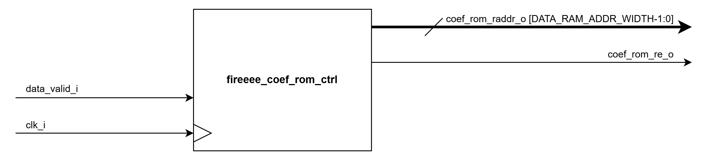
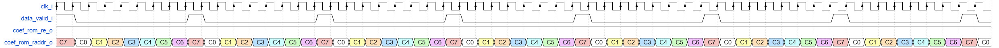

# fireeee_coef_rom_ctrl
Filter coefficient ROM controller

## File list
|File name|Description|
|:-|:-|
|[fireeee_coef_rom_ctrl.v]()|Verilog module|
|[fireeee_coef_rom_ctrl_tb.sv]()|SystemVerilog testbench|

## Parameters
|Parameter|Description|
|:-|:-|
|COEF_ROM_ADDR_WIDTH|Coefficient ROM address width|

## Port definition
### Input
|Port|Description|
|:-|:-|
|clk_i|Clck signal|
|data_valid_i|Data input valid signal|

### Output
|Port|Description|
|:-|:-|
|coef_rom_re_o|Read enable signal|
|coef_rom_raddr_o [COEF_ROM_ADDR_WIDTH-1:0]|Read address signal|

## Block diagram

## Timing chart

## Module description
TBD
