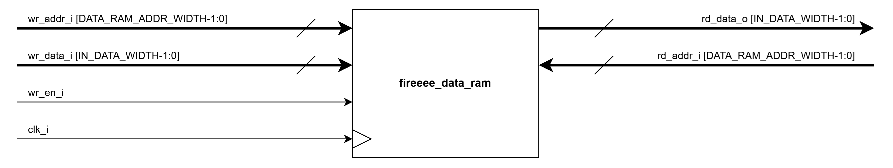

# fireeee_data_ram
Input data RAM

## File list
|File name|Description|
|:-|:-|
|[fireeee_data_ram.v]()|Verilog module|
|[fireeee_data_ram_tb.sv]()|SystemVerilog testbench|

## Parameters
|Parameter|Description|
|:-|:-|
|IN_DATA_WIDTH|Input data bit width|
|DATA_RAM_ADDR_WIDTH|Data RAM address width|

## Port definition
### Input
|Port|Description|
|:-|:-|
|clk_i|Clock signal|
|wr_en_i|Write enable signal|
|wr_addr_i|Write address signal|
|wr_data_i|Write data signal|
|rd_addr_i|Read address signal|

### Output
|Port|Description|
|:-|:-|
|rd_data_o|Read data signal|

## Block diagram

## Timing chart
TBD

## Module description
TBD
