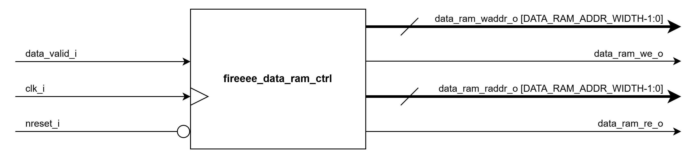

# fireeee_data_ram_ctrl
Input data RAM controller.

## File list
|File name|Description|
|:-|:-|
|[fireeee_data_ram_ctrl.v]()|Verilog module|
|[fireeee_data_ram_ctrl_tb.sv]()|SystemVerilog testbench|

## Paremeters
|Parameter|Description|
|:-|:-|
|DATA_RAM_ADDR_WIDTH|Data RAM address width|

## Port definition
### Input
|Port|Description|
|:-|:-|
|clk_i|Clock signal|
|data_valid_i|Data input valid signal|
|nreset_i|Asynchronous reset signal (Active LOW)|

### Output
|Port|Description|
|:-|:-|
|data_ram_we_o|Write enable signal|
|data_ram_waddr_o [DATA_RAM_ADDR_WIDTH-1:0]|Write address signal|
|data_ram_re_o|Read enable signal|
|data_ram_raddr_o [DATA_RAM_ADDR_WIDTH-1:0]|Read address signal|

## Block diagram

## Timing chart
TBD

## Module description
TBD
