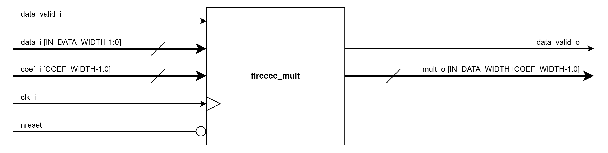
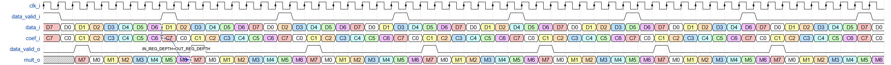

# fireeee_mult
Multiplier

## File list
|File name|Description|
|:-|:-|
|[fireeee_mult.v]()|Verilog module|
|[fireeee_mult_tb.sv]()|SystemVerilog testbench|

## Parameters
|Parameter|Description|
|:-|:-|
|IN_DATA_WIDTH|Input data bit width|
|COEF_WIDTH|Filter coefficient bit width|
|IN_REG_DEPTH|Input pipeline register depth|
|OUT_REG_DEPTH|Output pipeline register depth|

## Port definition
### Input
|Port|Description|
|:-|:-|
|clk_i|Clock signal|
|data_valid_i|Data input valid signal|
|data_i [IN_DATA_WIDTH-1:0]|Data input signal|
|coef_i [COEF_WIDTH-1:0]|Filter coefficient signal|
|nreset_i|Synchronous Reset (active LOW)|

### Output
|Port|Description|
|:-|:-|
|data_valid_o|Data valid signal for accumulation|
|mult_o [IN_DATA_WIDTH+COEF_WIDTH-1:0]|Muliplied data signal|

## Block diagram
### Summary

### Detailed
TBD

## Timing chart

## Module description
TBD
